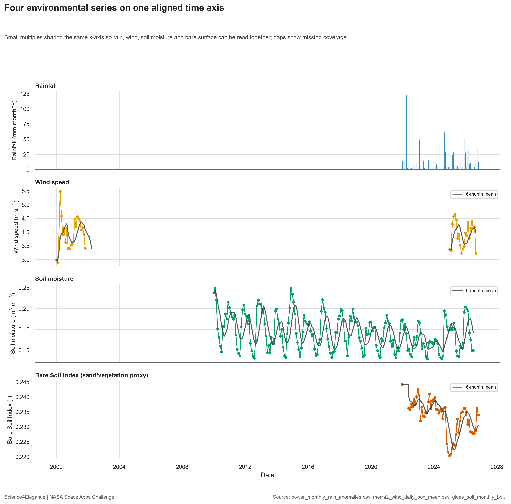

# KhettaraLens

**A Science4Elegance project for the NASA Space Apps Challenge 2026**

KhettaraLens explores how wind, rainfall, soil moisture, heat, and surface conditions relate to sand encroachment in the Merzouga region of Morocco. The project brings together satellite and climate datasets, plant-adaptation research, and clear visualizations to support evidence-informed discussion of local responses.

**Project website:** [khettaralens.netlify.app](https://khettaralens.netlify.app/)

## Project at a glance

| Focus | What we investigate |
|---|---|
| Wind | Wind speed and direction as factors in sand transport |
| Water | Rainfall patterns, soil moisture, and dry or wet periods |
| Land surface | Bare Soil Index (BSI) as an indicator of surface change |
| Adaptation | Plant traits and water-harvesting approaches relevant to dry environments |

The analysis is exploratory. Regional climate products and a surface index cannot, on their own, identify exact planting locations or prove that one environmental factor causes sand movement.

## Environmental overview

The chart below aligns the available rainfall, wind, soil-moisture, and bare-surface time series. Gaps indicate periods without overlapping observations.

## Repository guide

| Location | Contents |
|---|---|
| [`data-analysis/`](data-analysis/) | Analysis notebook, source datasets, visualization script, charts, and run-result guidance |
| [`data-analysis/notebooks/`](data-analysis/notebooks/) | Google Colab notebook and instructions for running it |
| [`data-analysis/data/team_data/`](data-analysis/data/team_data/) | Team datasets used by the visualization script |
| [`data-analysis/data/visualizations/`](data-analysis/data/visualizations/) | Generated individual and cross-dataset charts |
| [`data-analysis/results/`](data-analysis/results/) | Guidance for saving and sharing notebook outputs |
| [`data-analysis/docs/`](data-analysis/docs/) | Contribution guidance and project roadmap |

The deployed website is linked above. This repository contains the data-analysis materials listed here.

## Team

**Science4Elegance**

- Hatim Ourahou
- Achraf KHAIROUNI
- Hajar FADIL
- Taha Latif
- Ouiam Ouatat
- Douaa BADRI

## Data and interpretation

The project uses NASA MERRA-2, GLDAS, and POWER data, MODIS-derived BSI data, and curated plant-adaptation datasets. The notebook documents product versions and data provenance when it is run. Read the [data guide](data-analysis/data/README.md) for dataset descriptions and caveats.

- MERRA-2 and GLDAS grid cells represent regional conditions, not individual planting sites.
- BSI is a bare-surface change proxy; it is not a direct measurement of sand movement or vegetation health.
- Correlation and trend results describe patterns in the available data and do not establish cause and effect.
- Confirm the geographic coverage of team-provided rainfall and BSI files before interpreting them as site-specific.

## Getting started

For notebook-based climate analysis and visualization generation, follow the instructions in the [data-analysis guide](data-analysis/README.md). The [notebook guide](data-analysis/notebooks/README.md) covers Earthdata access, settings, and outputs.
