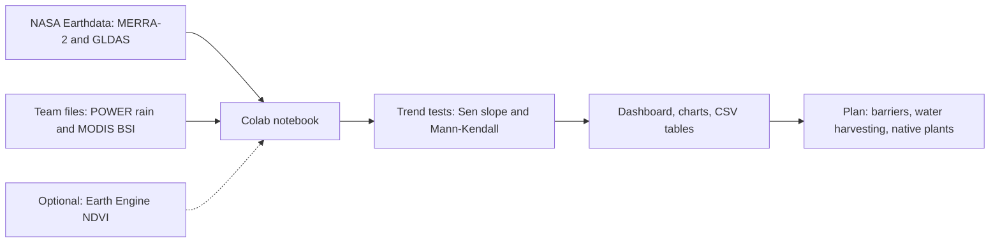

# Data analysis — trends in the Earth system

This folder contains everything the DATA part produces: a **Google Colab notebook**, the **team data files**, and the **results**.

## Quick start (3 steps)
1. Make a free **NASA Earthdata** account (https://urs.earthdata.nasa.gov) and authorise the app **"NASA GESDISC DATA ARCHIVE"** (Applications → Authorized Apps → Approve More Applications).
2. Open `notebooks/dune_detective_trends_EN.ipynb` in Google Colab (see `notebooks/README.md`).
3. Run the cells **one by one, in order** (Shift+Enter). Do not use "Run all".

## What the notebook does

| Step | What happens | Output |
|---|---|---|
| 4 | Wind and surface temperature (MERRA-2) | — |
| 5 | Soil moisture, rain, soil temperature (GLDAS) | — |
| 6 | NDVI and satellite heat (optional, Earth Engine) | — |
| 6b | Team data: rain (POWER) and BSI (MODIS) | `team_bsi_vs_rain.png` |
| 7 | Trend tests per variable and site | `trend_results.csv`, `annual_series.csv` |
| 8 / 8b | Summary chart and links between variables | `trend_summary.png`, `variable_links.png` |
| 9 | Interactive dashboard | `trend_dashboard.html` |
| 11 | Proof file | `README.md`, `data_provenance.csv` |

## How to read a result
- **slope_per_decade**: typical change every 10 years, in the variable's unit.
- **p_value**: below 0.05 means the trend is considered real (`significant = True`).
- `significant = False` means we **cannot claim** a trend. It does not prove that nothing changes.

## Where things are
| Path | Content |
|---|---|
| `notebooks/` | The notebook and how to run it |
| `data/` | Team CSV files and their data dictionary |
| `results/` | Outputs of the notebook (upload after each run) |
| `docs/` | Git workflow and project ideas |

## Common errors
| Message | Meaning | Fix |
|---|---|---|
| `EulaNotAccepted` | GESDISC app not authorised | Authorise it in your Earthdata profile |
| `Series too short or empty, skipped` | A site has no land data | Move the site inland or increase `BOX_HALF_WIDTH` |
| Very long cell | Hundreds of NASA files are being read | Wait 10-25 min and keep the tab open |
| Session disconnected | Colab lost the downloaded files | Re-run from step 1 |
| `NDVI skipped` | Earth Engine not enabled | Normal; set `USE_GEE = True` only when ready |
